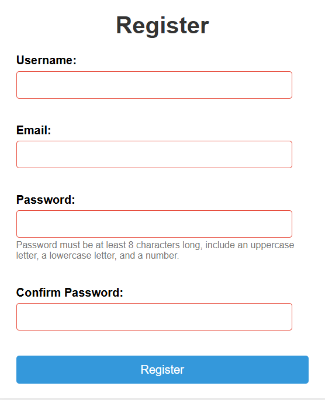
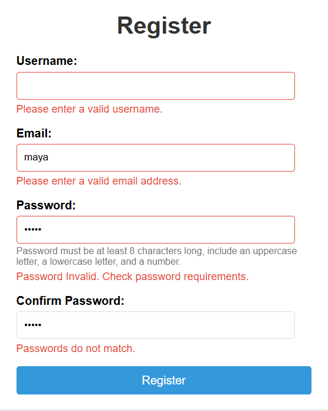
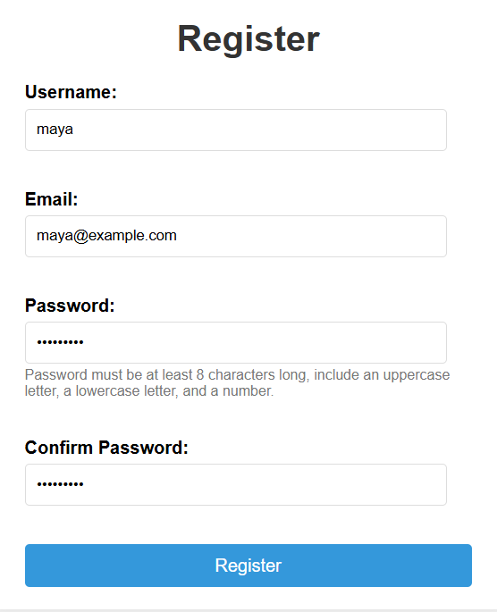

# Interactive Registration Form

A registration form that checks each field as you type, and again when you press Register.

## Description

A successful registration shows an alert, then the form is cleared. The values are saved in the browser and filled back in on the next visit.

Required fields start with a red border. The password rules sit under that field.

* Username is required. An empty username says “Please enter a valid username.”
* Email must be a valid email address. Otherwise it says “Please enter a valid email address.”
* Password must be at least 8 characters and include an uppercase letter, a lowercase letter, and a number. Otherwise it says “Password Invalid. Check password requirements.”
* While you type the confirm password, a mismatch says “Passwords do not match.”
* On Register, a mismatch or an empty confirm password says “Passwords do not match or is empty.”

The form turns off the browser’s own validation popup. The script checks each field and writes these messages.

If every field is valid and the passwords match, an alert says “The form data is valid and has been submitted successfully!” The form then clears.

Username, email, password, and confirm password are saved in the browser. The next time the page loads, those values are filled back in. The password is stored as plain text.

The completed example uses the username maya and the email maya@example.com.

## Screenshots

### Empty form

### Validation

### Ready to register

## Getting Started

### Dependencies

* A browser

### Installing

No install step.

### Executing program

Open `index.html` in a browser.

## Help

The password is stored as plain text. A mismatch while typing says “Passwords do not match.” On Register, a mismatch or an empty confirm password says “Passwords do not match or is empty.”

## Authors

[Mamadou Moussa Balde](https://www.linkedin.com/in/2mb/)

## Version History

* Current page
    * Empty form, field errors, and a valid entry for maya were captured

## License

This folder does not include a `LICENSE.md` file.

## Acknowledgments

* [README template](https://gist.github.com/DomPizzie/7a5ff55ffa9081f2de27c315f5018afc)

## Reflection Questions

### 1. How did event.preventDefault() help in handling form submission?

If you use event.preventDefault() inside the form's submit event listener, it stops the browser from doing what it normally does when you submit the form, which is to refresh the page or go to a new URL. This means that JavaScript can intercept the event, check the input data is correct, update the DOM dynamically, and store values asynchronously without stopping the user's session or losing the current application state.

### 2. What is the difference between using HTML5 validation attributes and JavaScript-based validation? Why might you use both?

HTML5 validation attributes (like required, pattern, or minlength) offer fast, built-in browser checks with zero custom code, but they don't allow for flexible styling or cross-browser visual consistency. JavaScript validation gives you complete control over the timing, messaging and visual presentation of errors, as well as support for complex logic like multi-field dependencies. Using both creates a progressive enhancement model where native HTML5 acts as a reliable first-pass safeguard, while JavaScript delivers a polished, customisable user experience.

### 3. Explain how you used localStorage to persist and retrieve the username. What are the limitations of localStorage for storing sensitive data?

When a form is submitted, the username is saved to localStorage using localStorage.setItem('username', value). This username is then retrieved on page load via localStorage.getItem('username') to dynamically populate the user interface. However, localStorage is not suitable for sensitive data because it stores plain text directly in the browser with no built-in encryption. Any script running in the domain can access it, making it highly vulnerable to Cross-Site Scripting (XSS) attacks. Furthermore, it lacks security controls like the HttpOnly flags available with cookies.

### 4. Describe a challenge you faced in implementing the real-time validation and how you solved it.

One of the main problems with real-time validation was stopping errors from appearing too quickly. This is when errors appear on the screen while the user is still typing their answer. To solve this, we waited until the user had finished typing before checking the answer. This stopped the user from seeing unnecessary error messages. Once an answer was marked as wrong, special codes were used to let the user know straight away that they had made a mistake.

### 5. How did you ensure that custom error messages were user-friendly and displayed at the appropriate times?

Custom error messages were designed to be clear and easy to follow. They explain exactly how to fix an entry, like "Password must be at least 8 characters", instead of just showing a generic error code. These messages were hidden by default and only appeared after a user interacted with a field (blur) or tried to submit the form. Also, error messages were placed directly below the fields they related to, and linked using ARIA attributes to make them easy to see and use.
